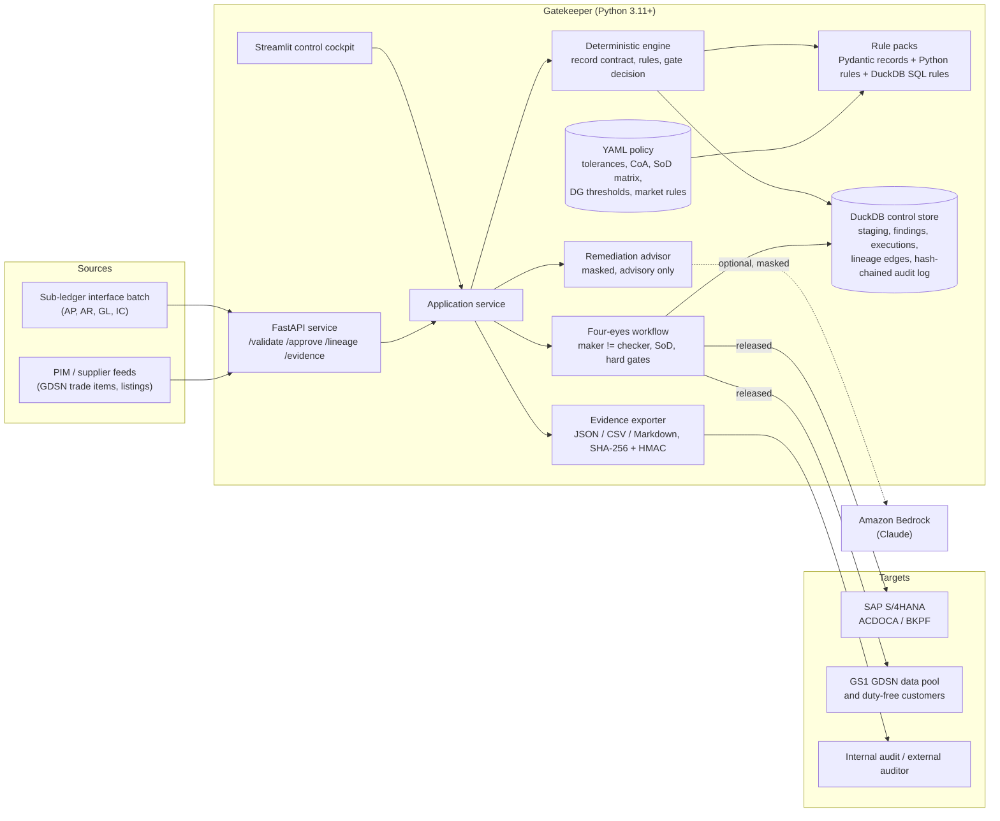
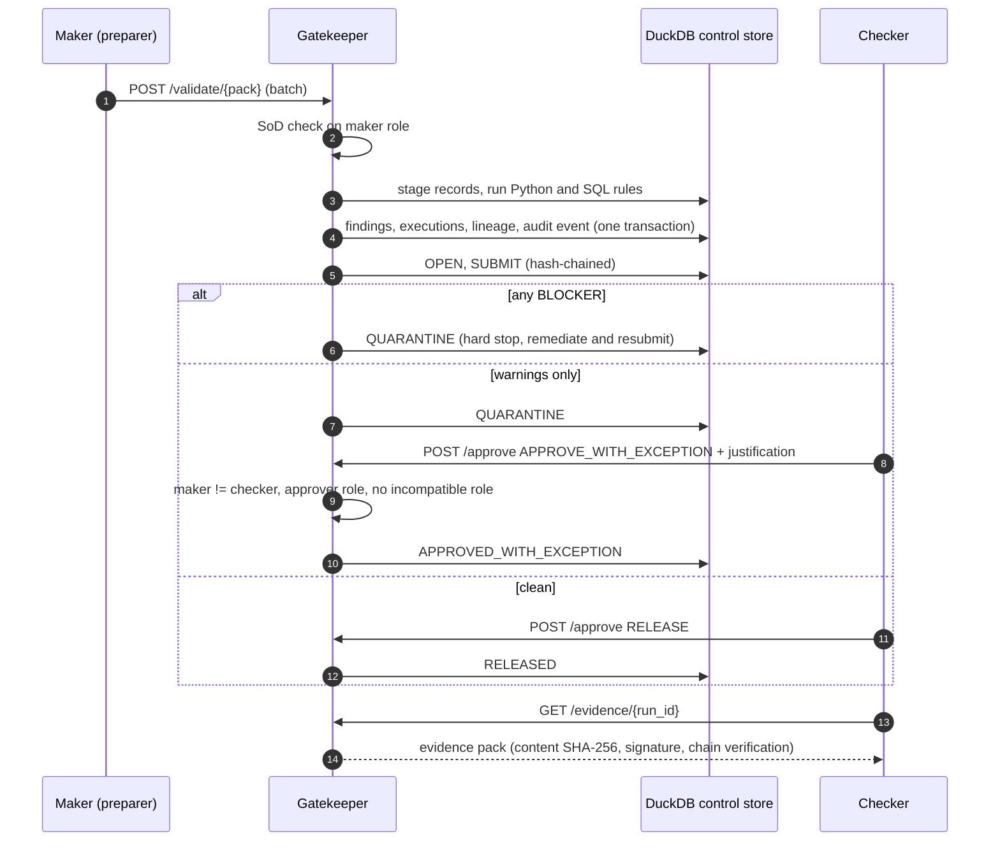

# Enterprise MDM & ICS Gatekeeper

[](https://github.com/ernestowendling/enterprise-mdm-ics-gatekeeper/actions/workflows/ci.yml)

A deterministic pre-release control gate that stops bad data before it reaches the ERP general
ledger or the GS1 GDSN data pool, and produces audit-grade evidence while doing so.

One shared control core (DuckDB evidence store, SHA-256 hash-chained audit log, attribute-level
lineage, four-eyes maker/checker workflow) carries two pluggable domain rule packs:

| Pack | Gate protects | Typical breaks caught |
| --- | --- | --- |
| **A. `finance_preclose_ics`** | Sub-ledger batch to SAP S/4HANA Universal Journal before period close | Unbalanced journals, trial balance not net-zero, direct postings to reconciliation accounts, uncleared suspense, intercompany that will not eliminate, stale or off-market FX rates, unmapped cost centres, self-approval, toxic SoD role pairs |
| **B. `travel_retail_gdsn`** | Prestige beauty trade items to the GDSN data pool and duty-free Sold-To / Ship-To customers | Wrong GTIN-14 check digits, duplicate GTINs, golden record conflicts, UN1266 perfumery without flashpoint or with the wrong packing group, physically impossible packaging hierarchies, blocked or restricted Sold-Tos, DG to Ship-Tos that cannot accept it |

An optional advisor drafts remediation text with Anthropic Claude on Amazon Bedrock. It never
decides: severities and gate decisions come only from deterministic rules
([ADR-001](docs/ADR-001-deterministic-gates-over-llm.md)), and the whole stack runs offline
with zero API keys.

## Architecture



### Gate and sign-off sequence



## Design decisions and trade-offs

| Decision | Trade-off accepted | Reference |
| --- | --- | --- |
| Deterministic rules decide; the LLM only drafts remediation | Gives up model-driven classification in exchange for re-performable, auditor-grade controls and immunity to prompt injection at the gate | [ADR-001](docs/ADR-001-deterministic-gates-over-llm.md) |
| Embedded DuckDB as engine and evidence store | Single-writer and detective (tamper-evident) immutability, in exchange for zero infrastructure, columnar set-based controls and portability to Fabric, Databricks or Snowflake | [ADR-002](docs/ADR-002-duckdb-immutable-audit-trail.md) |
| Policy in YAML, enforcement in code | Policy changes need a pull request, but every run records the policy hash, so control changes are evidenced | `configs/` |
| Records rejected at the contract become findings | Slightly noisier output, but no silent drops: a rejected line visibly unbalances its journal | `SCHEMA-001` |
| Event-sourced workflow state | No in-place updates; history is the state, and every transition is bound to an audit hash | `ledger/four_eyes.py` |
| Run-scoped lineage | Lineage is recorded as executed per run rather than as a static catalogue entry, which is what BCBS 239 reviewers ask to see | `lineage_edges` |

## Controls

The full mapping to SOX 404, the Swiss ICS (CO Art. 728a), BCBS 239, IAS 21, IFRS 10, GS1 GDSN,
IATA DGR and the IMDG Code is in [docs/control-matrix-mapping.md](docs/control-matrix-mapping.md).

| Pack A control | Engine | Pack B control | Engine |
| --- | --- | --- | --- |
| FIN-TB-001 Journal double-entry balance | SQL | TR-GTIN-001 GTIN-14 Modulo-10 and indicator | Python |
| FIN-TB-002 Trial balance net-zero (group currency) | SQL | TR-GTIN-002 GTIN uniqueness | SQL |
| FIN-TB-003 Sub-ledger to GL reconciliation tie-out | SQL | TR-MDM-001 Golden record consistency | SQL |
| FIN-TB-004 Suspense clearance | SQL | TR-DG-001 UN1266 Class 3 completeness | Python |
| FIN-IC-001 Intercompany net-zero | SQL | TR-HIER-001 Hierarchy weights | Python |
| FIN-FX-001 FX cut-off, staleness, translation | Python | TR-HIER-002 Hierarchy dimensions | Python |
| FIN-MD-001 CoA and cost centre mapping | Python | TR-MKT-001 Sold-To / Ship-To eligibility | Python |
| FIN-PER-001 Posting period cut-off | Python | TR-CUS-001 Customs classification and origin | Python |
| FIN-SOD-001 Independent approval | Python | | |
| FIN-SOD-002 Toxic role combinations | Python | | |

## Quickstart

```bash
python -m venv .venv && source .venv/bin/activate
pip install -e ".[dev,ui]"
pytest -v
```

API (OpenAPI at `http://127.0.0.1:8000/docs`):

```bash
uvicorn gatekeeper.api.main:app --reload

curl -s -X POST http://127.0.0.1:8000/validate/finance_preclose_ics \
  -H 'content-type: application/json' \
  -d '{"maker_id": "U20117", "use_synthetic_sample": true}'
```

Cockpit:

```bash
streamlit run app/cockpit.py
```

The cockpit switches between Pack A and Pack B, runs the gate on the synthetic batch, lists
blocked records, traces any downstream attribute back to its source columns and controls,
records four-eyes sign-off and exports the evidence pack.

## API

| Method | Path | Purpose |
| --- | --- | --- |
| GET | `/health` | Service status, audit chain validity, advisor mode |
| GET | `/packs` | Rule catalogue with framework mapping |
| POST | `/validate/{pack_id}` | Ingest a batch (or the synthetic sample) and run the gate |
| GET | `/runs/{run_id}` | Run header, workflow state, executions and findings |
| GET | `/quarantine` | Runs held at the gate |
| POST | `/approve` | Checker sign-off: `RELEASE` or `APPROVE_WITH_EXCEPTION` |
| GET | `/lineage/{run_id}/targets` | Downstream attributes recorded for a run |
| GET | `/lineage/{run_id}?target=SAP_S4HANA/ACDOCA.KSL` | Upstream trace with gating controls |
| GET | `/advice/{run_id}` | Advisory remediation drafts (`gate_effect` is always `NONE`) |
| GET | `/evidence/{run_id}` | Evidence pack (also `/summary.md` and `/findings.csv`) |
| GET | `/audit/verify` | Recompute the audit hash chain |

Four-eyes violations return `403` (self-approval, SoD) or `409` (hard gate, invalid
transition, missing justification).

## Configuration

| Variable | Default | Purpose |
| --- | --- | --- |
| `GATEKEEPER_DB_PATH` | `:memory:` | DuckDB database file for the API |
| `GATEKEEPER_CONFIG_DIR` | `configs/` | Policy directory |
| `GATEKEEPER_DATA_DIR` | `data/synthetic/` | Sample batches |
| `GATEKEEPER_EVIDENCE_HMAC_KEY` | unset | Enables HMAC-SHA256 signing of evidence packs |
| `GATEKEEPER_EVIDENCE_KEY_ID` | `local-hmac` | Key identifier recorded in the signature |
| `GATEKEEPER_BEDROCK_MODEL_ID` | unset | Bedrock model or inference profile ID; unset means offline fallback |
| `GATEKEEPER_BEDROCK_REGION` | AWS default | Bedrock region |
| `GATEKEEPER_PSEUDONYM_SALT` | `gatekeeper` | Salt for user pseudonymisation in advisor payloads |

To enable the advisor: `pip install -e ".[aws]"`, provide AWS credentials through the standard
chain and set `GATEKEEPER_BEDROCK_MODEL_ID`.

## Evidence pack

`GET /evidence/{run_id}` returns one JSON document containing the run header with input and
policy SHA-256, the control catalogue, population and exception counts per control, findings,
maker/checker events with their audit hashes, the run's audit events, chain verification and
as-run lineage. `content_sha256` covers the canonical JSON body; with a key configured, the
digest is signed with HMAC-SHA256. `verify_evidence_pack()` re-verifies both.

## Repository layout

```text
configs/                 YAML policy per pack
data/synthetic/          40-row synthetic batches with documented planted defects
docs/                    ADRs and control matrix mapping
src/gatekeeper/
  models.py              Pydantic v2 records, findings, lineage and workflow schemas
  engine.py              Deterministic runner, gate decision, lineage recording
  service.py             Application service shared by API and cockpit
  ledger/store.py        DuckDB schema, hash-chained audit log, lineage trace (recursive CTE)
  ledger/four_eyes.py    Maker/checker state machine with SoD enforcement
  rules/base.py          Rule, RecordRule, SqlRule, RulePack and registry
  rules/finance_ics.py   Pack A
  rules/travel_retail_mdm.py  Pack B
  advisor/               Optional Bedrock remediation adapter with offline fallback
  evidence/              Evidence pack builder, verifier, Markdown and CSV renderers
  api/main.py            FastAPI application
app/cockpit.py           Streamlit control cockpit
tests/                   pytest suite (rules, four-eyes, hash chain, advisor, evidence, API, UI)
```

## Path to production

| Reference implementation | Regulated deployment |
| --- | --- |
| DuckDB file | Fabric Lakehouse or Warehouse, Databricks Delta with Unity Catalog, or Snowflake; rule SQL is portable |
| YAML access snapshot | Role extract from Entra ID or SAP GRC per run |
| Hash chain, detective | Hash chain plus WORM storage and daily external anchoring of the head hash |
| HMAC evidence signature | Asymmetric KMS or Key Vault signature (HSM-backed) |
| `lineage_edges` | OpenLineage events into Microsoft Purview, Unity Catalog or Collibra |
| Synchronous API | Event-driven trigger from the interface layer (SAP Integration Suite, GDSN data pool inbound) |

## Data

All data is synthetic. GTINs use the GS1 prefix 952 reserved for demonstrations and examples.
Planted defects and the expected findings are listed in
[data/synthetic/README.md](data/synthetic/README.md).

## Licence

MIT. See [LICENSE](LICENSE). Security contact: see [SECURITY.md](SECURITY.md).
